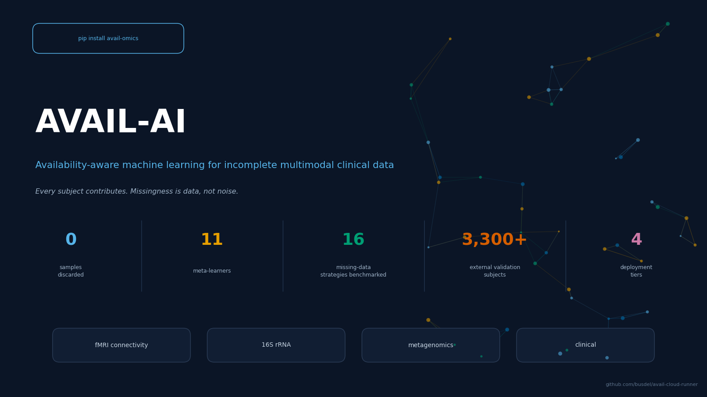
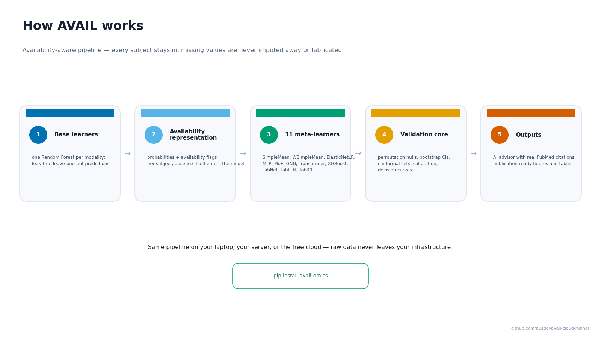
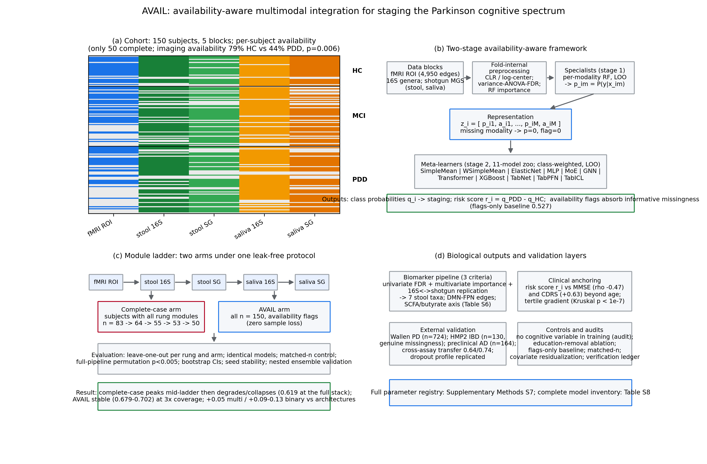
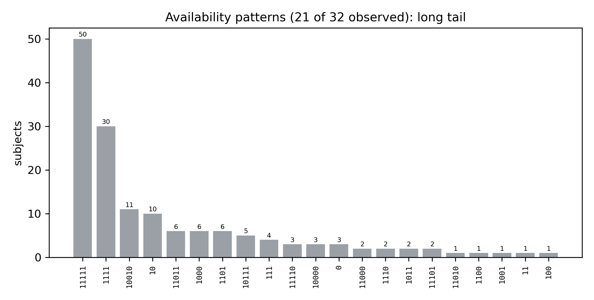
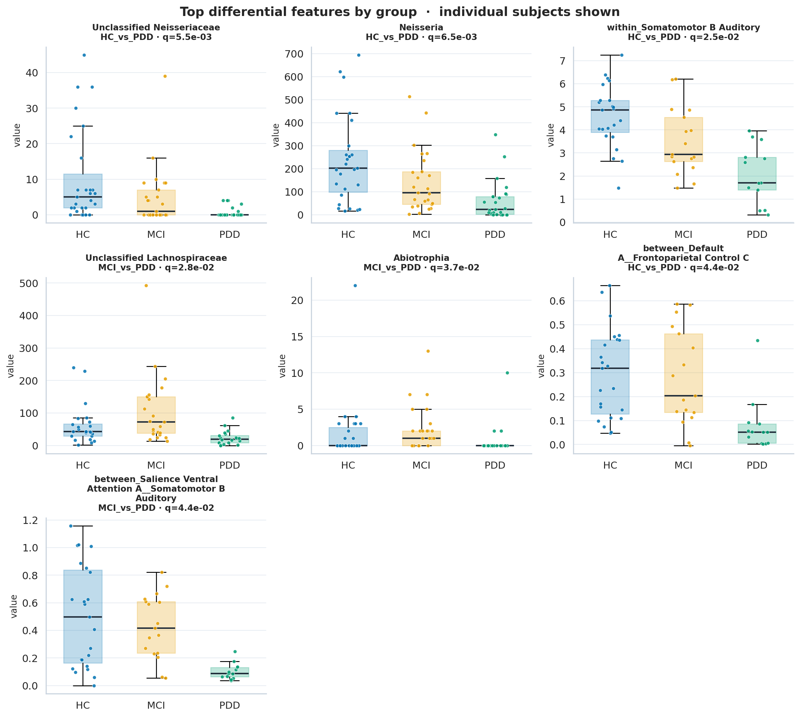
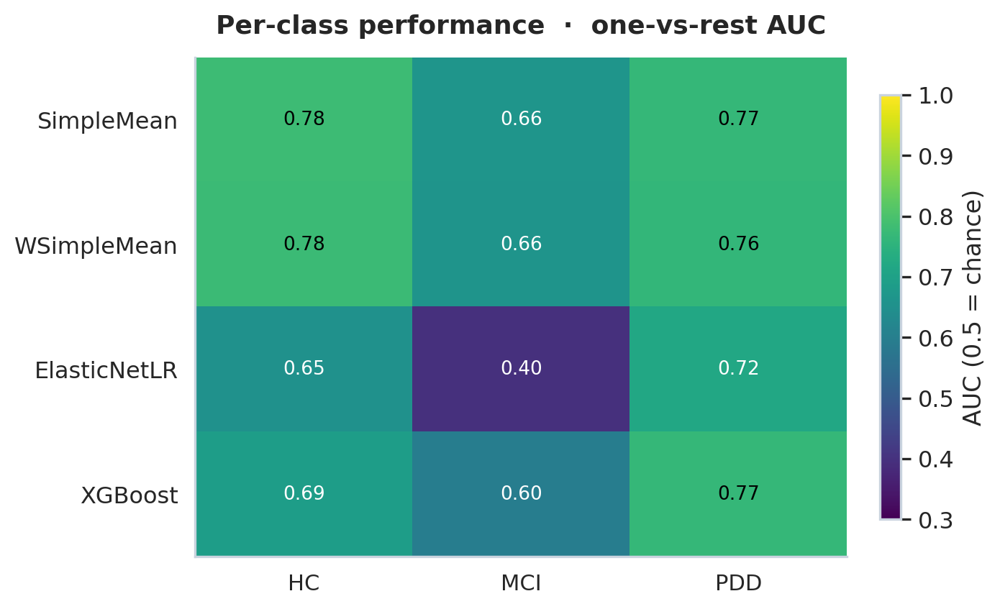
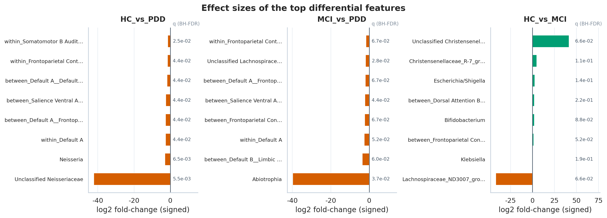
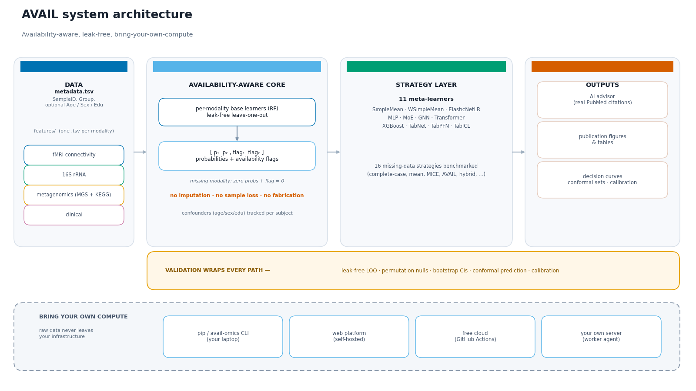

<p align="center">
  
</p>

<h1 align="center">AVAIL-AI</h1>
<p align="center"><b>Availability-Aware Multi-Omics Integration &amp; Learning</b><br>
Every subject with at least one modality contributes to the model &mdash; no complete-case discard; all-missing subjects are explicitly reported.</p>

<p align="center">
  <a href="https://pypi.org/project/avail-omics/"></a>
  <a href="https://pypi.org/project/avail-omics/"></a>
  <a href="https://github.com/busdel/avail-cloud-runner/blob/main/LICENSE"></a>
  <a href="https://github.com/busdel/avail-cloud-runner/releases"></a>
  <a href="https://pypi.org/project/avail-omics/"></a>
</p>

<p align="center">
  
</p>

---

## What is AVAIL-AI?

A framework for multimodal clinical cohorts with **missing modalities**. Built for the
oral&ndash;gut&ndash;brain axis in Parkinson's cognitive trajectory (HC vs MCI vs PDD),
combining fMRI connectivity, 16S rRNA, shotgun metagenomics (MGS + KEGG functional
modules) &mdash; and generalizable to **any tabular omics layers**, with genuine
missingness handled as data instead of discarded or fabricated.

### Pipeline

1. **Base learners** &mdash; one Random Forest per modality, leak-free leave-one-out (LOO)
2. **Meta-features** &mdash; `[p_1..p_K, flag_1..flag_K]` per subject (probabilities + availability flags)
3. **11 meta-learners** &mdash; SimpleMean, WSimpleMean, ElasticNetLR, MLP, MoE, GNN,
   Transformer, XGBoost, TabNet, TabPFN, TabICL
4. **Strategy benchmark** &mdash; 14 missing-data strategies (including hybrid) + decision curves,
   bootstrap CIs, conformal prediction sets, calibration
5. **Biomarker discovery** &mdash; SHAP importance + differential abundance (Mann&ndash;Whitney, BH-FDR)
6. **AI advisor** &mdash; model decision, biomarker plausibility with **real PubMed citations**
   (free NCBI E-utilities, no API key), manuscript-ready interpretation
7. **Publication figures** &mdash; 600 dpi PDF/PNG + 300 dpi TIFF

### Why it is different

- **Missingness is data, not noise** &mdash; availability flags enter the
  representation; sparse subjects are kept, never imputed away or dropped.
  Subjects with no modality at all are excluded by the public pipeline and
  reported; the paper's n=147 sensitivity is 0.663 vs 0.690 at rung 5 (Table S19).
- **Leak-free by construction** &mdash; fold-internal preprocessing, meta-level
  leave-one-out, permutation nulls at chance.
- **Benchmarked, not just built** &mdash; every design choice quantified against
  14 missing-data strategies and 11 meta-learners.
- **Validated outside the lab** &mdash; Wallen 2022 (PD, n=724), preclinical AD
  (n=164), HMP2 IBD, MetaCardis (n=1087), and independent rs-fMRI cohorts
  (OpenNeuro ds004392, ds005892) processed end-to-end with the same pipeline.
- **Group-aware readouts** &mdash; every run reports HC / MCI / PDD breakdowns:
  coverage by group, per-class one-vs-rest AUC, and group profiles of the top
  differential features (with individual subjects shown).
- **Yours to run** &mdash; free cloud, local runner, self-hosted, or your own
  server. Raw data is never sent to AI providers or used for model training;
  user jobs run on the compute you choose. The local-runner
  bundle can also act as a worker (`python run_me.py --serve`) so the web page
  dispatches jobs straight to your machine, no pip install needed.

## Gallery

<p align="center"></p>

| Method schematic | Availability patterns |
|---|---|
|  |  |

<p align="center"></p>

| Per-class performance | Effect sizes |
|---|---|
|  |  |

<p align="center"></p>

## Install the Python package

**PyPI: [avail-omics](https://pypi.org/project/avail-omics/)** (latest: **v1.0.17**, MIT, Python 3.10&ndash;3.13) &mdash; `pip install avail-omics`

```bash
pip install avail-omics            # core (CPU is fine)
pip install "avail-omics[deep]"    # + torch, TabNet, TabPFN, TabICL

avail-omics run-generic --data-root mydata --out results
avail-omics robustness  --data-root mydata --out results   # leak-free permutation
avail-omics sensitivity --data-root mydata --out results   # modality ablation
avail-omics figures     --out results
```

Generic data layout (any omics layers):

```
mydata/
  metadata.tsv        # SampleID + Group (+ optional Age, Education, Sex)
  features/
    brain.tsv         # rows = samples, first column = SampleID, rest = features
    stool16S.tsv
  compositional.txt   # optional: one modality name per line (log/CLR layers)
```

Outputs: `meta_benchmark_results.tsv`, `per_class_auc.tsv`, `loo_predictions.tsv`,
`biomarkers_top20_per_modality.tsv`, `diff_abundance_*.tsv`, publication figures,
and the AI advisor report (with PubMed literature).

## Live web tool

**Stable link: https://busdel.github.io/avail-cloud-runner/** (redirects to the current
session; access password shared on request while the manuscript is under review).

Upload a ZIP &rarr; automatic validation + AI data-quality feedback &rarr; run on the
**free cloud (GitHub Actions)** or **on your own computer** &rarr; AI decision report +
publication figures. The hosted interface **never executes user-uploaded jobs
on maintainer infrastructure**; only the fixed, de-identified demo runs
server-side: see [BYO_COMPUTE.md](BYO_COMPUTE.md) for the four deployment tiers
(local runner &middot; self-hosted &middot; your own cloud runner &middot; worker agent for
your own server), [DATA_SECURITY.md](DATA_SECURITY.md) for the outbound-call inventory
and offline mode, and [WORKER.md](WORKER.md) to attach your own server.

Imaging is first-class: raw rs-fMRI and T1 volumes are processed end-to-end
(Schaefer-100 connectivity + optional radiomics) on **your** machine &mdash; see
[IMAGING_ADAPTER.md](IMAGING_ADAPTER.md).

## LLM advisor

Optional AI automation (model selection, biomarker literature synthesis, results
interpretation). Any OpenAI-compatible endpoint works; Gemini is the default and
**Groq/OpenRouter free tiers** are automatic fallbacks on quota or provider
outages.

```bash
avail-omics set-key            # saves to ~/.config/avail/llm_key (0600)
avail-omics figures --out results
avail-omics advise  --out results
```

## Documentation

| File | What it covers |
|---|---|
| [DEPLOY.md](DEPLOY.md) | One-command deployment of the web platform |
| [BYO_COMPUTE.md](BYO_COMPUTE.md) | The four bring-your-own-compute tiers & security model |
| [WORKER.md](WORKER.md) | Attach your own server as a compute worker |
| [IMAGING_ADAPTER.md](IMAGING_ADAPTER.md) | Raw rs-fMRI / T1 processing protocol |
| [DATA_SECURITY.md](DATA_SECURITY.md) | Outbound-call inventory, offline mode |
| [CHANGELOG.md](CHANGELOG.md) | Release history |

## Data & tools

External datasets and methods used by the platform and the demo:

- **OpenNeuro ds004392** — Wylie KP et al., *Parkinson's disease, functional
  connectivity, and cognition* (CC0) — [DOI 10.18112/openneuro.ds004392.v1.0.2](https://doi.org/10.18112/openneuro.ds004392.v1.0.2)
- **OpenNeuro ds005892** — Kemp AS et al., *Resting-state MRI from HC, PD-NC
  and PD-MCI cohorts* (CC0) — [DOI 10.18112/openneuro.ds005892.v1.0.0](https://doi.org/10.18112/openneuro.ds005892.v1.0.0)
- **Schaefer atlas** — [DOI 10.1093/cercor/bhx179](https://doi.org/10.1093/cercor/bhx179)
- **Nilearn** — [DOI 10.3389/fninf.2014.00014](https://doi.org/10.3389/fninf.2014.00014) ·
  **AFNI** — [DOI 10.1006/cbmr.1996.0014](https://doi.org/10.1006/cbmr.1996.0014) ·
  **PyRadiomics** — [DOI 10.1158/0008-5472.CAN-17-0339](https://doi.org/10.1158/0008-5472.CAN-17-0339)
- **scikit-learn** — [JMLR 2011](https://jmlr.org/papers/v12/pedregosa11a.html) ·
  **SHAP** — [arXiv:1705.07874](https://arxiv.org/abs/1705.07874) ·
  **PubMed E-utilities** — [NCBI documentation](https://www.ncbi.nlm.nih.gov/books/NBK25499/)

## Repository layout

```
avail_ai/avail_ai/      # the avail-omics Python package
run_generic.py          # generic multi-omics pipeline entry point
BYO_COMPUTE.md          # bring-your-own-compute tiers & security guide
.github/workflows/run.yml   # free-cloud compute backend (GitHub Actions)
```

## Citation

If you use AVAIL-AI in academic work, please cite it &mdash; machine-readable
metadata is in [CITATION.cff](CITATION.cff):

```bibtex
@software{delice2026avail,
  title   = {AVAIL-AI: availability-aware multimodal learning for incomplete clinical cohorts},
  author  = {Delice, Busranur},
  version = {1.0.14},
  year    = {2026},
  url     = {https://github.com/busdel/avail-cloud-runner}
}
```

The companion manuscripts are in preparation; this entry will be updated with the DOIs.

## License

MIT &mdash; see [LICENSE](LICENSE).
