<p align="center">
  
</p>

<h1 align="center">AVAIL-AI</h1>
<p align="center"><b>Availability-Aware Multi-Omics Integration &amp; Learning</b><br>
Every subject with at least one modality contributes to the model &mdash; no complete-case discard; all-missing subjects are explicitly reported.</p>

<p align="center">
  <a href="https://pypi.org/project/avail-omics/"></a>
  <a href="https://pypi.org/project/avail-omics/"></a>
  <a href="https://github.com/busdel/avail-cloud-runner/blob/main/LICENSE"></a>
  <a href="https://github.com/busdel/avail-cloud-runner/releases"></a>
  <a href="https://pypi.org/project/avail-omics/"></a>
</p>

<p align="center">
  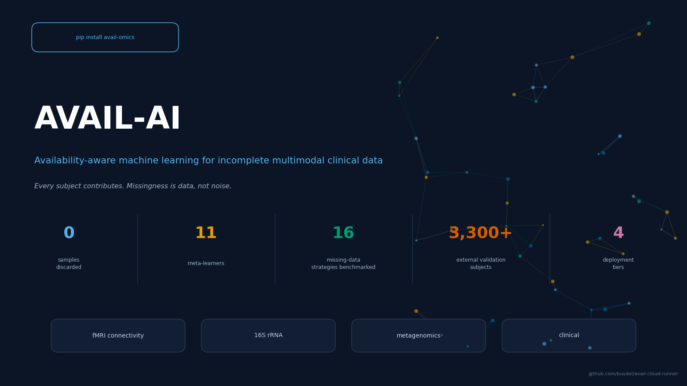
</p>

---

## What is AVAIL-AI?

A framework for multimodal clinical cohorts with **missing modalities**. Built for the
oral&ndash;gut&ndash;brain axis in Parkinson's cognitive trajectory (HC vs MCI vs PDD),
combining fMRI connectivity, 16S rRNA, shotgun metagenomics (MGS + KEGG functional
modules) &mdash; and generalizable to **any tabular omics layers**, with genuine
missingness handled as data instead of discarded or fabricated.

### Pipeline

1. **Base learners** &mdash; one Random Forest per modality, leak-free leave-one-out (LOO)
2. **Meta-features** &mdash; `[p_1..p_K, flag_1..flag_K]` per subject (probabilities + availability flags)
3. **11 meta-learners** &mdash; SimpleMean, WSimpleMean, ElasticNetLR, MLP, MoE, GNN,
   Transformer, XGBoost, TabNet, TabPFN, TabICL
4. **Strategy benchmark** &mdash; 14 missing-data strategies (including hybrid) + decision curves,
   bootstrap CIs, conformal prediction sets, calibration
5. **Biomarker discovery** &mdash; SHAP importance + differential abundance (Mann&ndash;Whitney, BH-FDR)
6. **AI advisor** &mdash; model decision, biomarker plausibility with **real PubMed citations**
   (free NCBI E-utilities, no API key), manuscript-ready interpretation
7. **Publication figures** &mdash; 600 dpi PDF/PNG + 300 dpi TIFF

### Why it is different

- **Missingness is data, not noise** &mdash; availability flags enter the
  representation; sparse subjects are kept, never imputed away or dropped.
  Subjects with no modality at all are excluded by the public pipeline and
  reported; the paper's n=147 sensitivity is 0.663 vs 0.690 at rung 5 (Table S19).
- **Leak-free by construction** &mdash; fold-internal preprocessing, meta-level
  leave-one-out, permutation nulls at chance.
- **Benchmarked, not just built** &mdash; every design choice quantified against
  14 missing-data strategies and 11 meta-learners.
- **Role-separated public evidence** &mdash; MetaCardis anchor (n=1087;
  reproduction + coverage), HMP2/IBD independent replication (n=130;
  complete-block subset), and OpenNeuro ds004392 imaging failure-mode (n=53;
  no detectable transfer). The companion cohort (n=150) is an end-to-end
  application check; Wallen 2022, preclinical AD and the label-free
  reconstruction belong to the companion paper. A public coverage audit
  (ds004856) is reported separately (see below), not as a performance claim.
- **Group-aware readouts** &mdash; every run reports HC / MCI / PDD breakdowns:
  coverage by group, per-class one-vs-rest AUC, and group profiles of the top
  differential features (with individual subjects shown).
- **Yours to run** &mdash; free cloud, local runner, self-hosted, or your own
  server. Raw data is never sent to AI providers or used for model training;
  user jobs run on the compute you choose. The local-runner
  bundle can also act as a worker (`python run_me.py --serve`) so the web page
  dispatches jobs straight to your machine, no pip install needed.

## Validation suite and coverage audit

The software paper uses role-separated evidence rather than a leaderboard:

| Role | Dataset | n | What it tests |
|---|---|---:|---|
| Anchor | MetaCardis | 1087 (CC 536) | natural, informative missingness |
| Independent replication | HMP2 / IBD | 130 | different disease; complete-block subset |
| Imaging failure mode | OpenNeuro ds004392 | 53 | imaging-only transfer; failure handling |
| Companion application | AVAIL cohort | 150 | end-to-end software use; no new biology |
| Coverage audit | OpenNeuro ds004856 | 295 labeled | complete-case bias only |

The **ds004856 coverage audit** is intentionally not a performance result.
Its processed OpenNeuro tables contain 295 amyloid-labeled subjects, but the
complete-case intersection (MRI + tau + cognition) has **60 subjects and zero
amyloid-positive subjects**; all 73 MRI-absent subjects are positive and the
60 tau-available subjects are negative. A single availability indicator
reaches AUC 0.82, so complete-case and all-subject AUCs are not interpretable
as biological estimates. The cohort is retained only to show that
complete-case analysis can be structurally non-estimable; it is not used to
claim diagnostic accuracy.

<p align="center">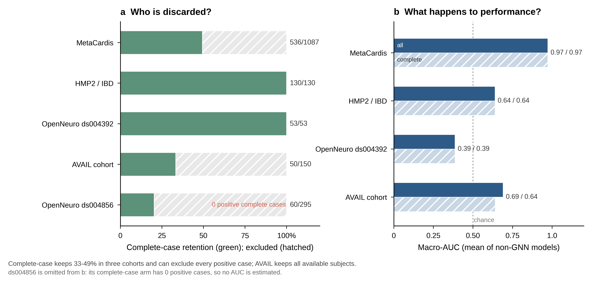</p>

Source table: [`validation_suite.tsv`](docs/assets/viz/validation_suite.tsv).

The companion AVAIL cohort (n=150) is an application/regression check:
biological interpretation belongs to the companion paper; this repository
uses the same verified cohort to exercise the command line, figures, report
and R export end to end.

## Gallery

<p align="center">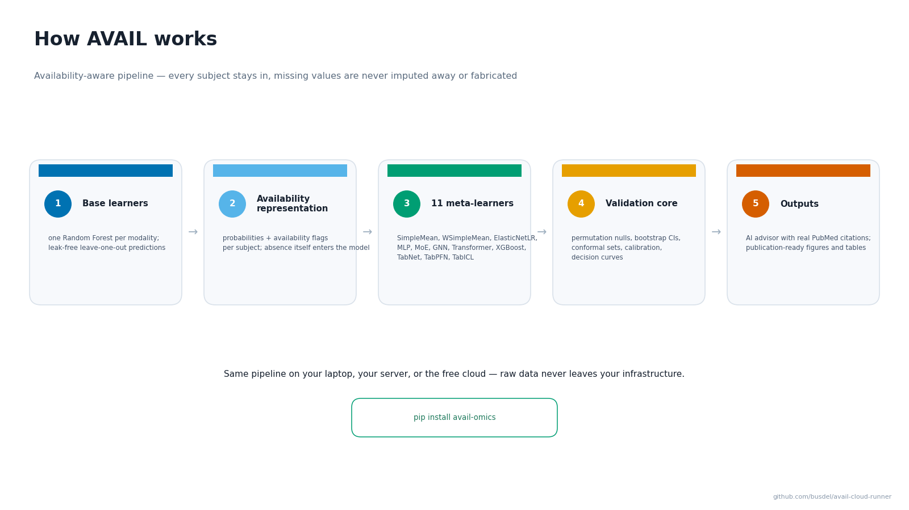</p>

| Method schematic | Availability patterns |
|---|---|
| 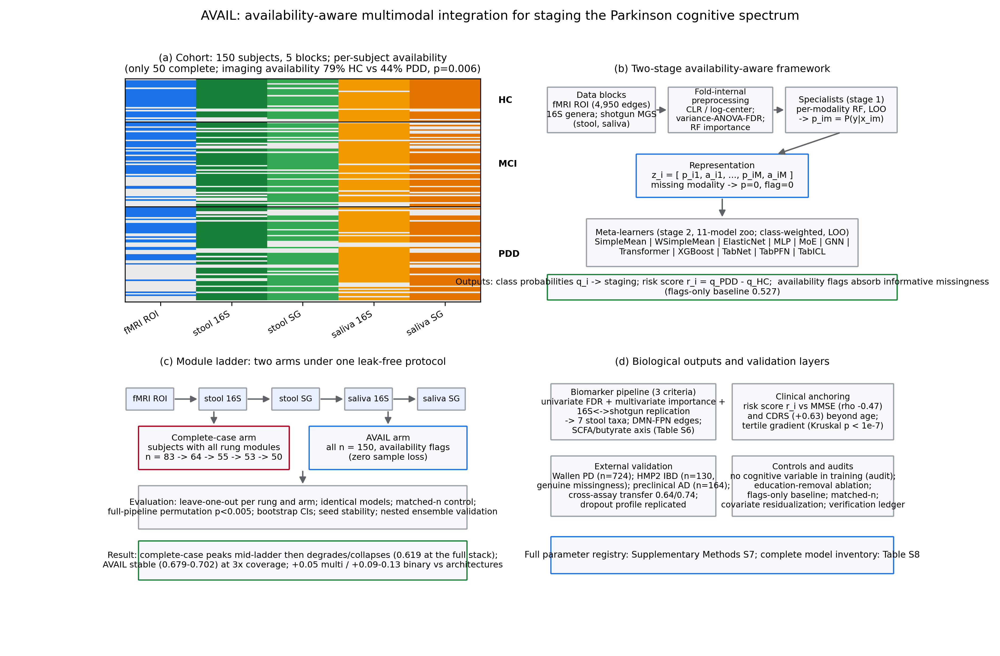 | 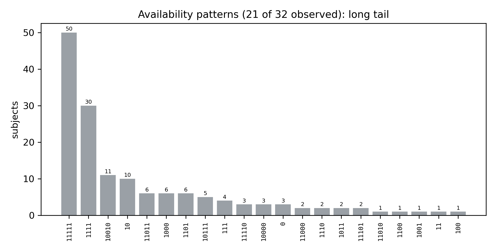 |

<p align="center">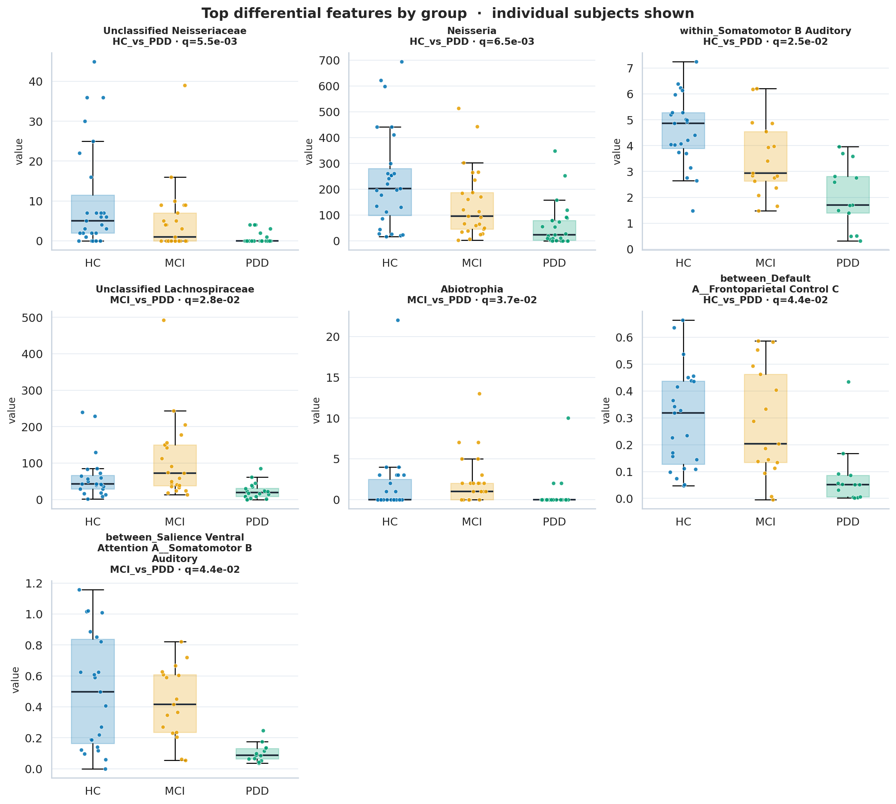</p>

| Per-class performance | Effect sizes |
|---|---|
| 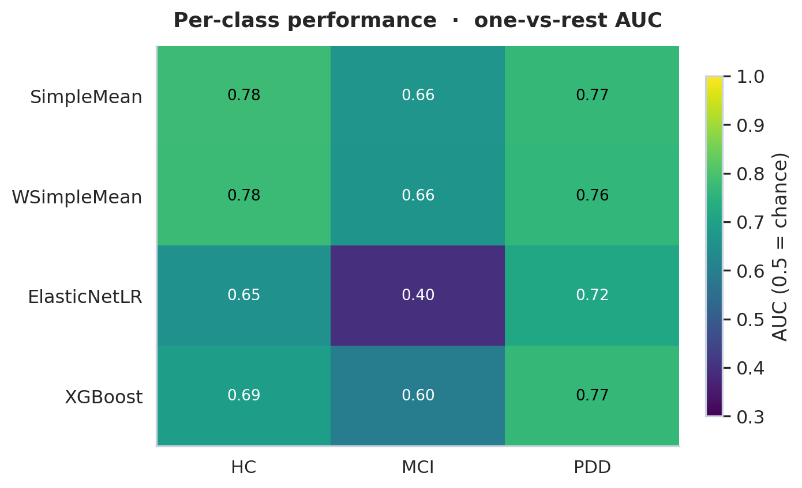 | 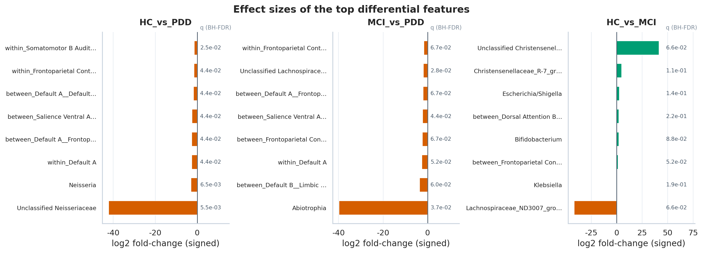 |

<p align="center">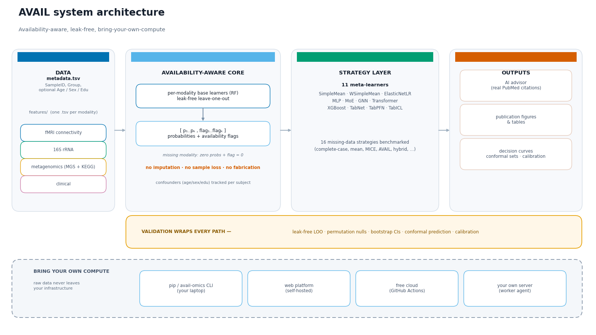</p>

## Install the Python package

**PyPI: [avail-omics](https://pypi.org/project/avail-omics/)** (latest: **v1.7.0**, MIT, Python 3.10&ndash;3.13) &mdash; `pip install avail-omics`

```bash
pip install avail-omics            # core (CPU is fine)
pip install "avail-omics[deep]"    # + torch, TabNet, TabPFN, TabICL

avail-omics run-generic --data-root mydata --out results
avail-omics robustness  --data-root mydata --out results   # leak-free permutation
avail-omics sensitivity --data-root mydata --out results   # modality ablation
avail-omics figures     --out results
avail-omics report      --out results   # AI advisor report (own LLM key)
avail-omics chat        --out results   # results-grounded Dr. AVAIL agent
avail-omics plot --out results --data-root mydata \
    --type network,roc,availability,umap,volcano,forest   # soft-palette figures
```

Generic data layout (any omics layers):

```
mydata/
  metadata.tsv        # SampleID + Group (+ optional Age, Education, Sex)
  features/
    brain.tsv         # rows = samples, first column = SampleID, rest = features
    stool16S.tsv
  compositional.txt   # optional: one modality name per line (log/CLR layers)
```

Outputs: `meta_benchmark_results.tsv`, `per_class_auc.tsv`, `loo_predictions.tsv`,
`biomarkers_top20_per_modality.tsv`, `diff_abundance_*.tsv`, publication figures,
and the AI advisor report (with PubMed literature).

## Visualization toolkit (v1.7.0)

Soft-palette, publication-ready figures from the package:

| Network | ROC / calibration | Availability |
|---|---|---|
| 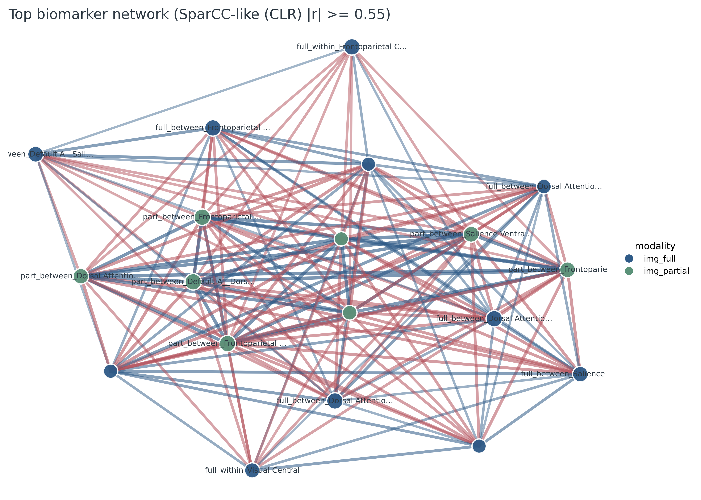 | 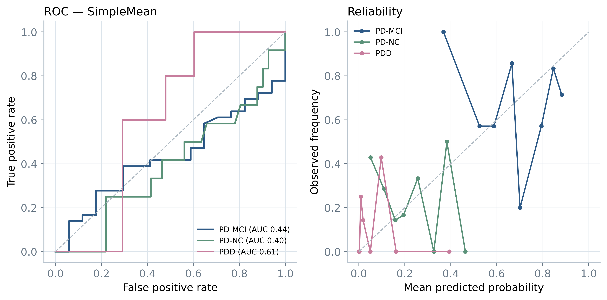 | 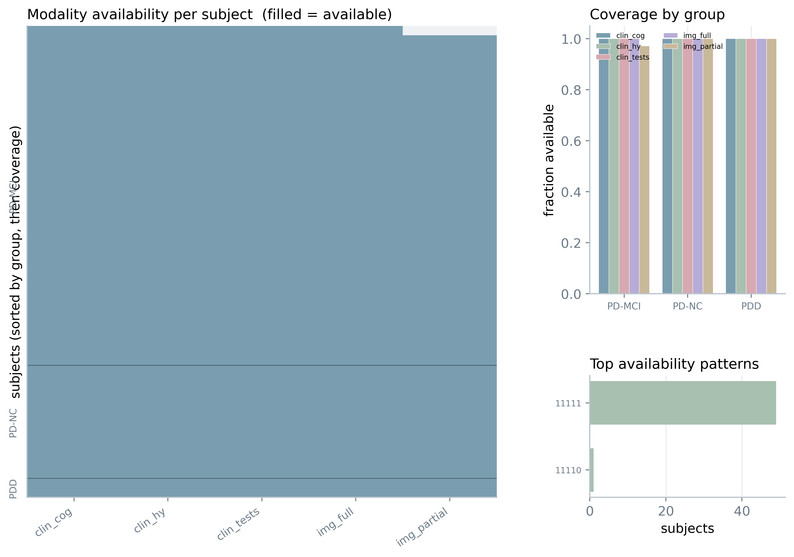 |

```bash
avail-omics plot --out results --data-root mydata \
  --type network,roc,availability,umap,volcano,forest

# module-aware network, SparCC-like correlations, cross-module edges
avail-omics plot --out results --data-root mydata --modality taxa \
  --type network_modules --method sparcc --combined --taxonomy taxonomy.tsv
```

Figures use the manuscript CPAL palette and a journal-style preset (Arial,
7–8 pt, 600 dpi PDF/PNG/TIFF, panel letters). For dense networks, use the
clean `module_panels` (selected-module networks + cross-module heatmap) or
`module_summary` (module sizes, cross-module heatmap, strongest pairs)
instead of a hairball; `--method sparcc|spearman|pearson` selects the
correlation.

Also included: UMAP/PCA, volcano and forest plots. Correlations: `sparcc`
(CLR approximation), `spearman` or `pearson`. Full gallery:
https://busdel.github.io/avail-cloud-runner/viz/

**Module-aware network** — automatic community detection, per-module panels
or `--combined` single view with cross-module edges, hub highlighting,
taxonomy colouring and a `cross_module_edges.tsv` export.

<p align="center">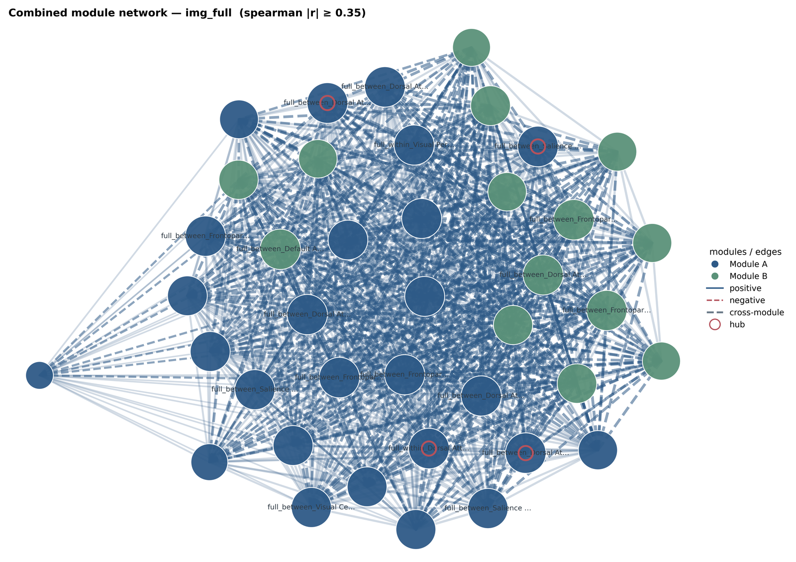</p>

## Multi-omics sample-loss figures

Reference-style figures for the de-identified AVAIL cohort (n=87;
85 with at least one layer, 40 complete-case; fMRI 53, saliva16S 77,
stool16S 67):

| Sample loss / UpSet | Multi-omics networks | Key subnetwork |
|---|---|---|
| 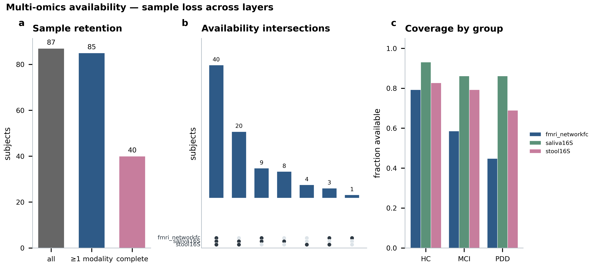 | 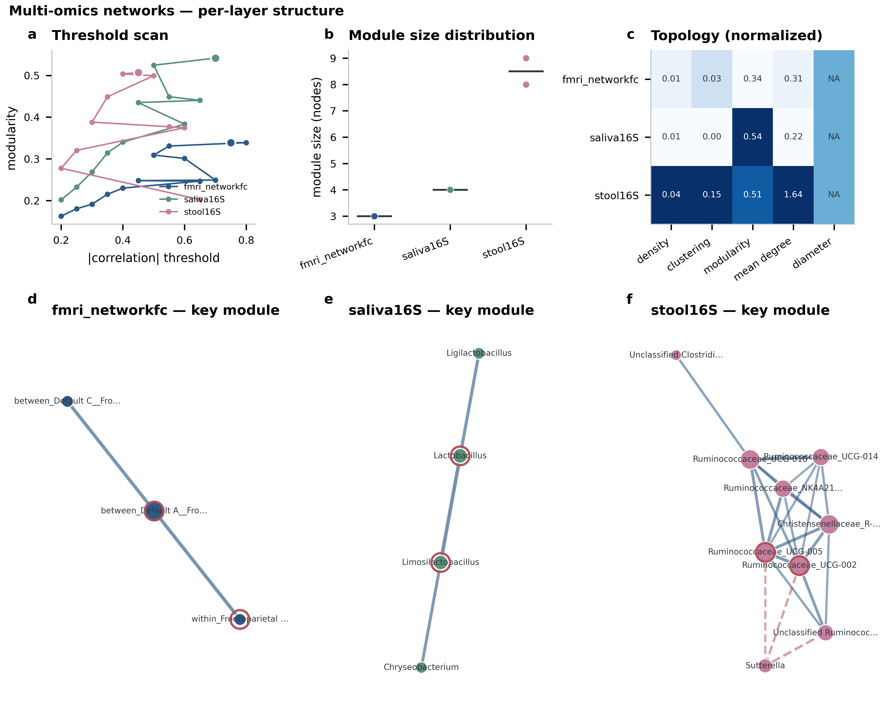 | 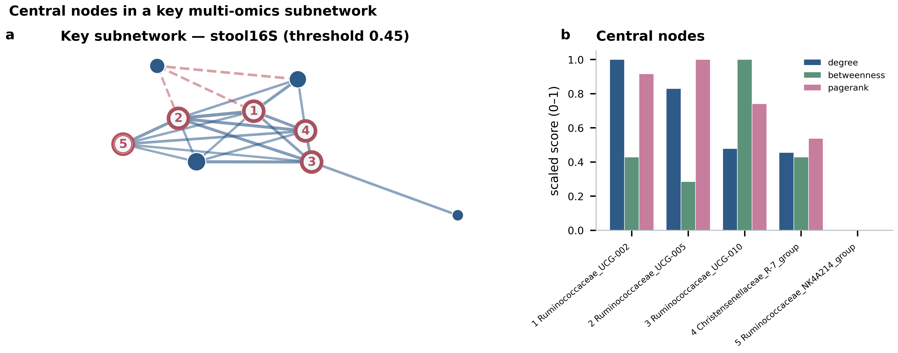 |

Full gallery: https://busdel.github.io/avail-cloud-runner/viz/
Source: `docs/avail_multomics_figures.py`; provenance:
`docs/assets/viz/multomics_provenance.json`.

## R interoperability

```bash
avail-omics export-r --out results --data-root mydata \
  --dest r_export --taxonomy taxonomy.tsv
```

Writes phyloseq-ready `otu_table.tsv`, `sample_data.tsv`, `tax_table.tsv`,
`feature_table.tsv`, result/network tables and an R guide covering
**phyloseq**, **vegan**, **igraph**, **SpiecEasi**, **NetCoMi** and
**mixOmics/PMA**. No R packages are bundled. Full guide:
[docs/R_INTEROP.md](docs/R_INTEROP.md).

## Live demo and own-data analysis

- **Public demo (demo-only):** https://avail-ai.onrender.com &mdash; fixed,
  de-identified cohort; **no uploads**, no server-side user jobs; four
  meta-learners on the free CPU tier. The full **11-model zoo** is available
  in the package/full run. The free instance may take ~30&ndash;60 s to wake.
- **Canonical project page:** https://busdel.github.io/avail-cloud-runner/
- **Own data:** install the package, use the local runner, or attach your own
  worker. See [BYO_COMPUTE.md](BYO_COMPUTE.md) (four deployment tiers),
  [DATA_SECURITY.md](DATA_SECURITY.md) and [WORKER.md](WORKER.md).
- **Reviewers:** start with [REVIEWER_GUIDE.md](REVIEWER_GUIDE.md); the
  manuscript package and cover letter carry the access details.

Imaging is first-class: raw rs-fMRI and T1 volumes are processed end-to-end
(Schaefer-100 connectivity + optional radiomics) on **your** machine &mdash; see
[IMAGING_ADAPTER.md](IMAGING_ADAPTER.md).

## LLM advisor

Optional AI automation (model selection, biomarker literature synthesis, results
interpretation). Any OpenAI-compatible endpoint works; Gemini is the default and
**Groq/OpenRouter free tiers** are automatic fallbacks on quota or provider
outages.

```bash
avail-omics set-key            # saves to ~/.config/avail/llm_key (0600)
avail-omics report --out results   # llm_advisor.json + llm_advisor_report.md
avail-omics chat --out results     # results-grounded Dr. AVAIL agent
avail-omics figures --out results
avail-omics advise  --out results
```

## Documentation

| File | What it covers |
|---|---|
| [DEPLOY.md](DEPLOY.md) | One-command deployment of the web platform |
| [BYO_COMPUTE.md](BYO_COMPUTE.md) | The four bring-your-own-compute tiers & security model |
| [WORKER.md](WORKER.md) | Attach your own server as a compute worker |
| [IMAGING_ADAPTER.md](IMAGING_ADAPTER.md) | Raw rs-fMRI / T1 processing protocol |
| [DATA_SECURITY.md](DATA_SECURITY.md) | Outbound-call inventory, offline mode |
| [CHANGELOG.md](CHANGELOG.md) | Release history |

## Data & tools

External datasets and methods used by the platform and the demo:

- **OpenNeuro ds004392** — Wylie KP et al., *Parkinson's disease, functional
  connectivity, and cognition* (CC0) — [DOI 10.18112/openneuro.ds004392.v1.0.2](https://doi.org/10.18112/openneuro.ds004392.v1.0.2)
- **OpenNeuro ds005892** — Kemp AS et al., *Resting-state MRI from HC, PD-NC
  and PD-MCI cohorts* (CC0) — [DOI 10.18112/openneuro.ds005892.v1.0.0](https://doi.org/10.18112/openneuro.ds005892.v1.0.0)
- **Schaefer atlas** — [DOI 10.1093/cercor/bhx179](https://doi.org/10.1093/cercor/bhx179)
- **Nilearn** — [DOI 10.3389/fninf.2014.00014](https://doi.org/10.3389/fninf.2014.00014) ·
  **AFNI** — [DOI 10.1006/cbmr.1996.0014](https://doi.org/10.1006/cbmr.1996.0014) ·
  **PyRadiomics** — [DOI 10.1158/0008-5472.CAN-17-0339](https://doi.org/10.1158/0008-5472.CAN-17-0339)
- **scikit-learn** — [JMLR 2011](https://jmlr.org/papers/v12/pedregosa11a.html) ·
  **SHAP** — [arXiv:1705.07874](https://arxiv.org/abs/1705.07874) ·
  **PubMed E-utilities** — [NCBI documentation](https://www.ncbi.nlm.nih.gov/books/NBK25499/)

## Repository layout

```
avail_ai/avail_ai/      # the avail-omics Python package
run_generic.py          # generic multi-omics pipeline entry point
BYO_COMPUTE.md          # bring-your-own-compute tiers & security guide
.github/workflows/run.yml   # free-cloud compute backend (GitHub Actions)
```

## Citation

If you use AVAIL-AI in academic work, please cite it &mdash; machine-readable
metadata is in [CITATION.cff](CITATION.cff):

```bibtex
@software{delice2026avail,
  title   = {AVAIL-AI: availability-aware multimodal learning for incomplete clinical cohorts},
  author  = {Delice, Busranur},
  version = {1.0.14},
  year    = {2026},
  url     = {https://github.com/busdel/avail-cloud-runner}
}
```

The companion manuscripts are in preparation; this entry will be updated with the DOIs.

## License

MIT &mdash; see [LICENSE](LICENSE).
