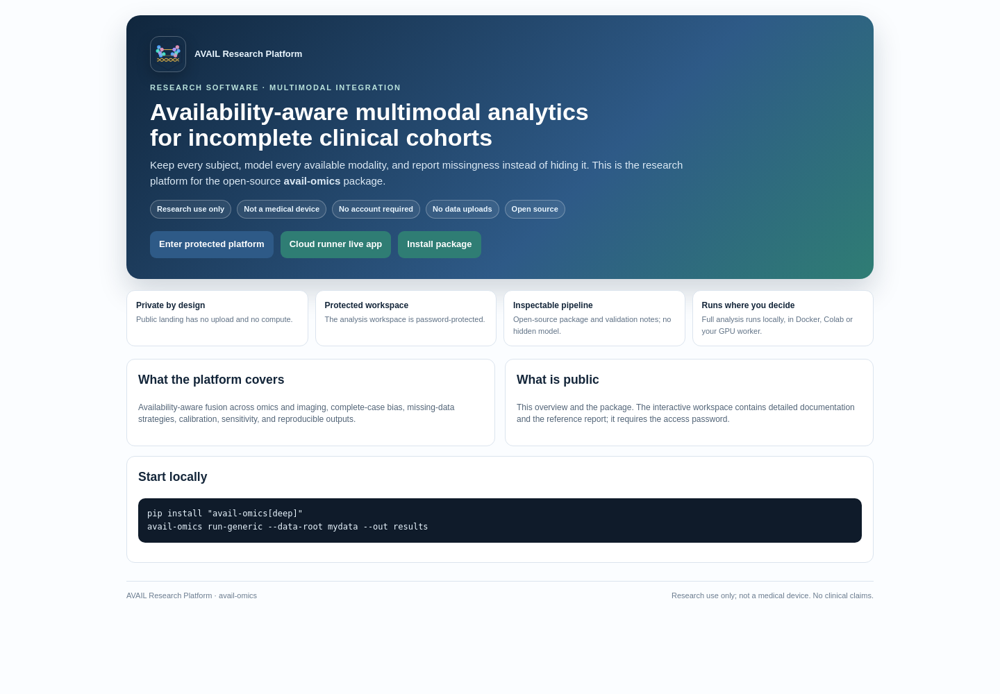
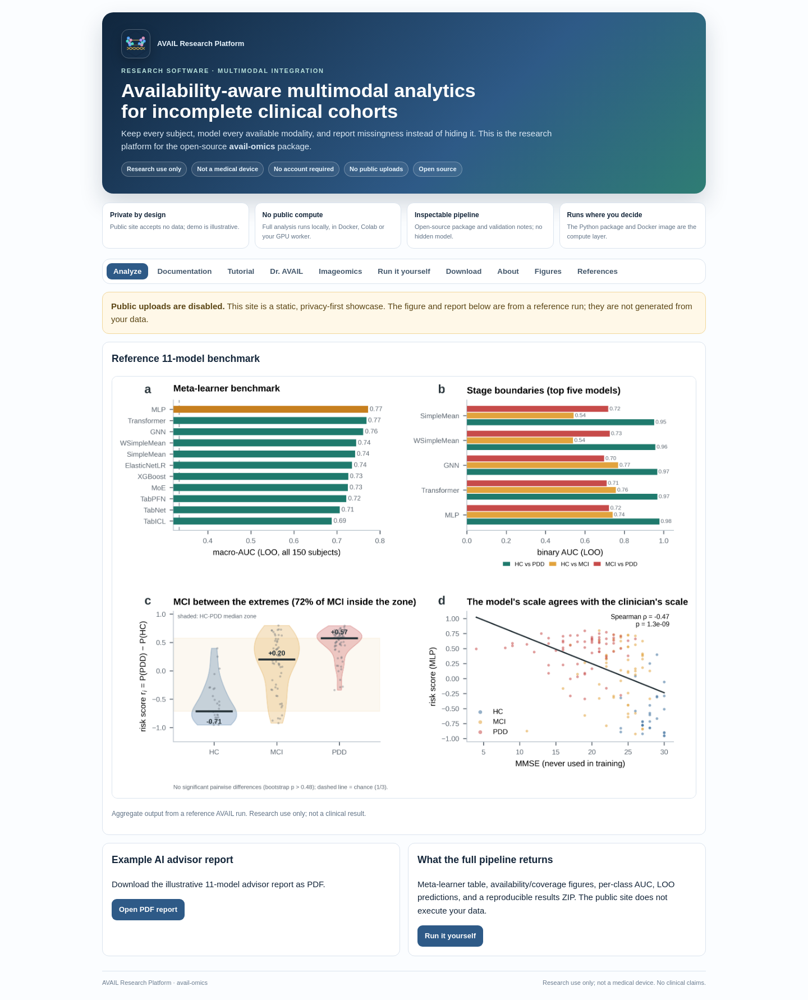
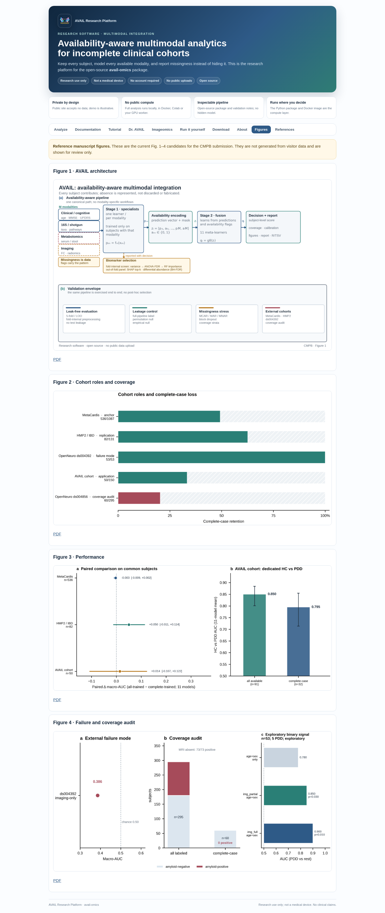
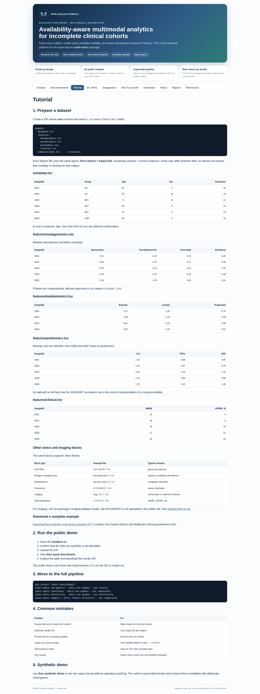

# Web application overview (reviewer-facing)

## Access
- Public landing: `https://avail-research-platform.pages.dev/`
- Protected workspace: `https://avail-research-platform.pages.dev/platform`
- Username: `avail`; password is provided in the cover letter.
- The public landing has no upload and no compute. The workspace is a static,
  password-protected showcase.
- `/demo` is intentionally not available (HTTP 404).

## What the workspace contains
- **Analyze**: fixed reference run, 11-model benchmark, example report, and
  explanation of what the full pipeline returns.
- **Figures**: current manuscript reference figures 1-4 (architecture,
  cohort roles, paired 11-model performance, failure/coverage audit).
- **Documentation / Tutorial**: generic AVAIL layout, run-it-yourself path,
  Docker, and Colab instructions.
- **Dr. AVAIL / Imageomics**: research-only assistant and imaging context.
- **Download / About / References**: package, data-protection statement, and
  citations.

## Privacy model
- Public uploads are disabled (`AVAIL_ALLOW_SERVER_RUN=0` in the public
  deployment profile).
- The public demo is synthetic/de-identified and fixed.
- Real analysis runs in the package, local Docker/Colab, or a bring-your-own
  compute worker.
- No account is created by the public landing; no user data is used for model
  training. Research use only; not a medical device.

## Screenshots

## Reviewer notes
- The Figures tab shows the same four reference figures as the manuscript
  package; it does not generate figures from visitor data.
- The Analyze tab is a fixed illustrative reference run, not a live result for
  any visitor.
- The platform is a communication/demo layer; the reproducible computation is
  the Python package and its command line.
